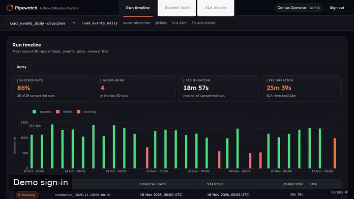
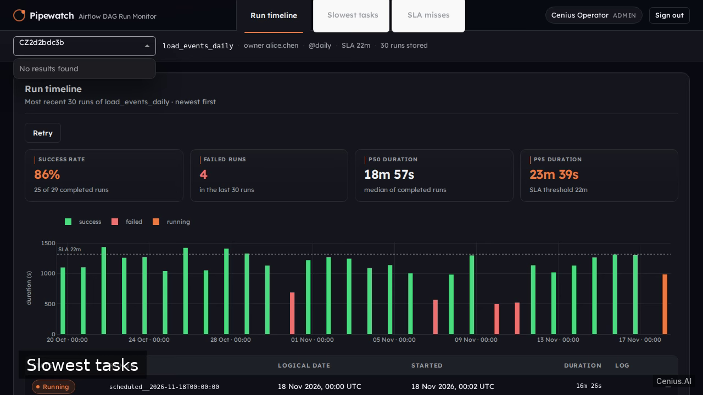
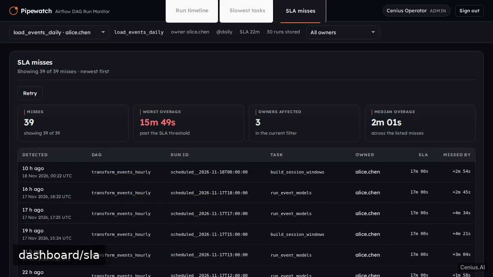
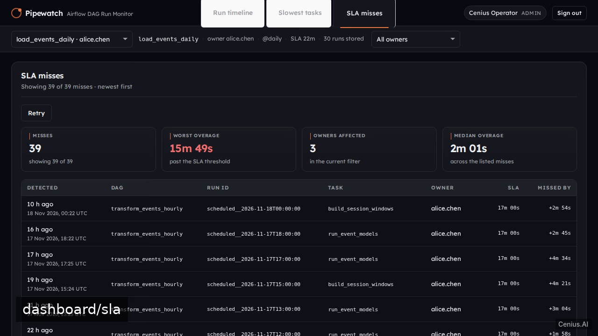

# Pipewatch Airflow DAG Run Monitor — complete Full-stack app monitoring dashboard example app

Most open-source monitoring dashboard projects ship a skeleton. **Pipewatch Airflow DAG Run Monitor** ships the whole thing: production-ready Full-stack app source, seeded demo data, and a Pipewatch Airflow DAG Run Monitor install script that runs in minutes. Pipewatch is a lightweight, open-source run-health dashboard for Airflow users who do not want to open the full Airflow UI. Apache-2.0-licensed — [remix Pipewatch Airflow DAG Run Monitor on cenius.ai](https://cenius.ai/marketplace/p/pipewatch-airflow-dag-run-monitor?ref=gh&utm_campaign=pipewatch-airflow-dag-run-monitor-webapp) for your own branded build.


[](LICENSE)  [](https://cenius.ai)

[](https://cenius.ai/marketplace/p/pipewatch-airflow-dag-run-monitor?ref=gh&utm_campaign=pipewatch-airflow-dag-run-monitor-webapp)

> **▶ [Open & edit in cenius.ai](https://cenius.ai/marketplace/p/pipewatch-airflow-dag-run-monitor?ref=gh&utm_campaign=pipewatch-airflow-dag-run-monitor-webapp)** — one click to an editable workspace: describe changes in plain English, get an instant preview, one-click deploy and host. Modifications made on the platform come with full rebrand & relicense rights.

_Local clone? See [Quick start](#quick-start) below. cenius.ai is the zero-setup path._

## Demo



▶ **[Watch the full demo video](https://cenius.ai/marketplace/p/pipewatch-airflow-dag-run-monitor?ref=gh&utm_campaign=pipewatch-airflow-dag-run-monitor-webapp)** — the complete walkthrough, playing on the project's cenius.ai page · [MP4 file](.github/media/demo.mp4)

## Screenshots

  

## Quick start

```bash
./install.sh   # installs dependencies + seeds demo data
```

See [`INSTALL.md`](INSTALL.md) for full setup and usage instructions.

## Features

- Demo sign-in gate
- DAG run timeline
- Slowest tasks leaderboard with p50/p95
- Failed task log excerpt viewer
- SLA miss alerts with owner filter
- Session view state persistence

## Architecture

`install.sh` provisions dependencies and seeds demo data so the app starts with something real to explore. The Full-stack app codebase (57 files) is self-contained — no external services needed to evaluate it. Top-level layout: `assets/`, `pipewatch/`, `tests/`. See [`INSTALL.md`](INSTALL.md) for complete setup instructions.

## Usage guide

### Overview

This is **Pipewatch Airflow DAG Run Monitor** — an HTTP API + web UI. This document covers the surface area you can use, with copy-pasteable examples for each entry point. For setup, see `INSTALL.md`.

### Quickstart

After completing the install steps in `INSTALL.md`:

```bash
flask --app app run --debug    # start the server
## in another terminal:
curl http://localhost:8000/
```

### Endpoints

_No HTTP routes were auto-extracted. If the server registers routes dynamically (e.g. config-driven), document them here manually._

### Worked example

1. Boot the server (`flask --app app run --debug`).
2. Hit a smoke-test endpoint:

```bash
curl -sS http://localhost:8000/
```

3. If you get a JSON / HTML response, the server is healthy. Inspect `.env` if it errors with an auth/config failure.

### Reference

#### Entry points

_No explicit entry points declared in this project's manifests._

### Next steps

- Read [INSTALL.md](./INSTALL.md) if anything in the Quickstart didn't work.
- Inspect `.env.example` for the full list of environment variables this project understands.
- See [README.md](./README.md) for the architecture diagram + feature list.

_Full guide: [`USAGE.md`](USAGE.md)_

## FAQ

### What's the quickest way to self-host Pipewatch Airflow DAG Run Monitor?

Everything you need ships in this repo: clone it, run `./install.sh` to install dependencies and seed demo data, then follow [`INSTALL.md`](INSTALL.md) to start it. No external services required.

### Is there a no-code way to modify Pipewatch Airflow DAG Run Monitor?

Open it on [cenius.ai](https://cenius.ai/marketplace/p/pipewatch-airflow-dag-run-monitor?ref=gh&utm_campaign=pipewatch-airflow-dag-run-monitor-webapp) and describe the changes you want in plain English — the platform modifies the app and gives you a new, downloadable build.

### What is Pipewatch Airflow DAG Run Monitor built with?

Pipewatch Airflow DAG Run Monitor is a Full-stack app application — and this repository holds the complete, runnable source, not a stripped-down sample. Highlights include failed task log excerpt viewer.

### Is it OK to ship Pipewatch Airflow DAG Run Monitor as part of a product?

Confirmed free for commercial use — MIT terms let you incorporate, resell, or ship it in any product. [LICENSE](LICENSE).

### Is white-labeling Pipewatch Airflow DAG Run Monitor allowed?

Rebranding is straightforward under the MIT license — change what you want in the source. Or [open it on cenius.ai](https://cenius.ai/marketplace/p/pipewatch-airflow-dag-run-monitor?ref=gh&utm_campaign=pipewatch-airflow-dag-run-monitor-webapp): the platform handles the changes and grants full rebrand rights on the result.

## License & rebranding

Released under the [Apache License 2.0](LICENSE) (© 2026 Cenius AI) — free for personal and commercial use. The Cenius name/logo are trademarks (see NOTICE).

**Need a customized version?** [Remix this app on cenius.ai](https://cenius.ai/marketplace/p/pipewatch-airflow-dag-run-monitor?ref=gh&utm_campaign=pipewatch-airflow-dag-run-monitor-webapp) — modifications made on the platform come with **full rebrand & relicense rights** over your derivative.

## Built with cenius.ai

This entire application — code, design, seeded demo data — was generated on **[cenius.ai](https://cenius.ai)** from a plain-English description.

- 🚀 [Build your own app on cenius.ai](https://cenius.ai)
- 🎛️ [Remix Pipewatch Airflow DAG Run Monitor on the marketplace](https://cenius.ai/marketplace/p/pipewatch-airflow-dag-run-monitor?ref=gh&utm_campaign=pipewatch-airflow-dag-run-monitor-webapp) — open it in a workspace, prompt for changes, and ship your own version.

More open-source apps: [the Cenius-ai catalog](https://github.com/Cenius-ai) · [showcase index](https://github.com/Cenius-ai/showcase)
